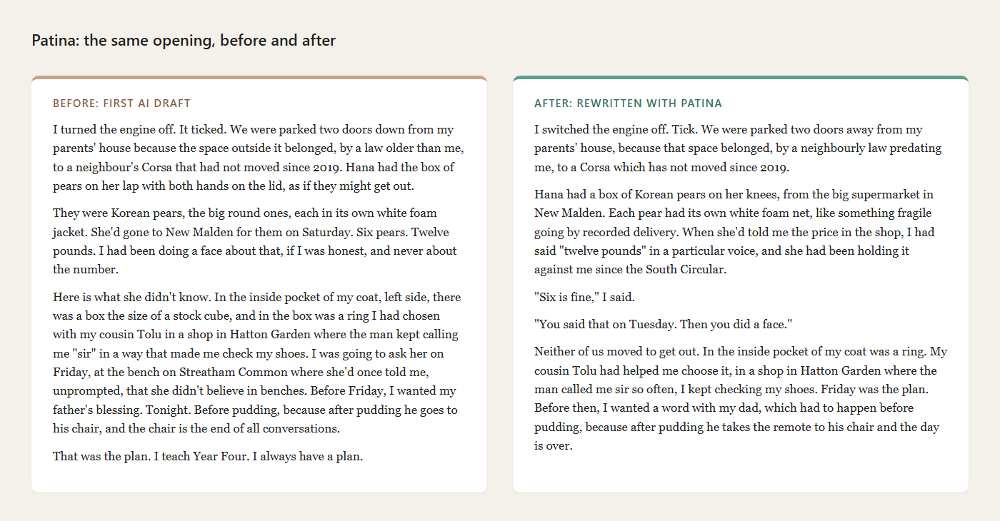

# Patina

**Write with AI. Still sound like you.**
Patina marks the lines in your draft that read as machine-written, and tells you why.

An AI draft saves time. It also tends to leave a few sentences behind that nobody you know would say. Patina finds those lines and explains what gives each one away. It never touches your file, so the rewriting, and the voice, stay yours.

It works on writing you did yourself too. If people keep telling you your work sounds like ChatGPT, Patina shows which habits they are hearing, and you decide which to keep.

## What it checks

- Tells: the stock phrases and sentence shapes readers have learned to spot.
- Predictability: the sentences a language model would have written first, ranked, so you know where to start.
- The Copybook: each sentence measured against two published novels for its grammar, its words, how it opens and where its commas fall. Lines outside the human range get marked.
- Short lines: a brief, a filter and a cold read for headlines and taglines, so you can see if a stranger understands a line before it goes live.

## Before and after

The opening of a short story: the first AI draft, and the same scene after rewriting with Patina.



Every draft is different, so the best test is your own. It's free: run it on something you wrote.

## Quick start

You need Node 18 or later. Nothing else to install.

```bash
npx github:taxmanhaven/patina-showcase check my-draft.md
```

Each mark comes back with its line and column, how serious it is, and why it reads as machine-written:

```
my-draft.md:3:1   warning connector-open  "Moreover,"  Let the ideas join by their own logic.
my-draft.md:3:14  warning style-words     "delve"      Use the plain word a person would say.
```

Not sure what a mark means? `patina explain style-words`.

Pick the profile that fits the reader with `--profile`: `fiction`, `web` (the default), `email`, `pro-email`, `technical`, `playful`, `captions`, `spoken`, `headline`, `testimonial` or `ui`. If you clone the repo, `node tools/cli.mjs` does the same without npx.

### Inside your AI app

Patina also runs as an MCP server, so Claude, Cursor or any app that speaks MCP can check its own draft before it hands it to you. It runs on your machine, offline, and never changes your text. The app sees four tools (`patina_check`, `patina_explain`, `patina_rules`, `patina_profiles`) and one prompt, `rewrite_with_patina`: check, rewrite only the marked lines, check again.

Claude Code:

```bash
claude mcp add patina -- npx -y github:taxmanhaven/patina-showcase mcp
```

Claude Desktop, Cursor and others take the same command in their MCP settings:

```json
{
  "mcpServers": {
    "patina": { "command": "npx", "args": ["-y", "github:taxmanhaven/patina-showcase", "mcp"] }
  }
}
```

Then ask: "Write the launch email, and run it past Patina before you show me."

### In CI, or before a commit

The exit code is 0 on a pass and 1 when the draft fails its profile, so a pull request can't merge a page that reads as boilerplate. `--format github` puts the marks inline on the pull request:

```yaml
- uses: actions/checkout@v4
- uses: actions/setup-node@v4
  with: { node-version: 20 }
- run: npx -y github:taxmanhaven/patina-showcase check docs/*.md --format github
```

`--format json` gives the same marks to your own scripts. `--fail-on any` fails on any mark; `--fail-on never` only reports.

### Settings

`patina init` writes a `.patinarc.json`. Patina looks for one in the file's folder and every folder above it:

```json
{
  "profile": "web",
  "profiles": { ".md": "web", ".txt": "email" },
  "disable": ["em-dash"],
  "protect": ["A line you wrote on purpose"],
  "failOn": "gate"
}
```

`disable` takes a rule (`style-words`), a family (`triplet`) or a measure (`rhythm`, `specificity`). `patina rules` lists them all.

### More tools

For lots of short app strings, use `batch`:

```bash
node tools/patina.mjs batch strings.json --report report.md
```

For a headline or tagline, fill in `templates/headline-brief.txt`, then:

```bash
node tools/patina.mjs brief brief.txt
node tools/patina.mjs lines --brief brief.txt --candidates candidates.txt
```

Write each candidate as `technique | line / subline`. The techniques are in `craft/headlines.md`.

### Optional extras

- The predictability map and the cold reader call a language model through an OpenAI-compatible API (Prima Labs by default). Put your key in the `PRIMALABS_API_KEY` environment variable. Patina reads it in the process and never prints it.
  `node tools/predict.mjs my-draft.md --out predict.md`
- The Copybook's grammar layer needs Python 3.12 with spaCy and wordfreq, which you install yourself:
  ```bash
  pip install "spacy>=3.8,<3.9" wordfreq
  python -m spacy download en_core_web_md
  python tools/intro_commas.py check my-draft.md
  ```
  To place a whole draft against the human ranges: `node tools/sentences.mjs label my-draft.md --out draft.lab.jsonl` (needs the key), then `python tools/anatomy.py draft.lab.jsonl draft.an.jsonl`, then `node tools/copybook.mjs --draft draft.an.jsonl --panel`.

The Copybook ships with `norms/norms.json`, the human ranges, so it works without the books. The norms are numbers only. No book text is included.

## What is in here

| Folder | What |
|---|---|
| `tools/` | the command line (`cli.mjs`), the MCP server (`mcp.mjs`), the checker, the predictability map, the Copybook and the tests (`npm test`) |
| `craft/` | the headline craft guide and the sentence codebook |
| `norms/` | human ranges measured on two published novels, with their sources |
| `templates/` | the headline brief |
| `glossaries/` | an example list of a product's design words, for the design-leak check |
| `examples/` | the before and after picture above |
| `corpus/` | one public-domain chapter (Willa Cather, *My Antonia*) used as a human anchor |

## Honest limits

- Patina points; it does not promise that any detector will pass your text. Expert readers see through word swaps, so the fix is your own rewrite.
- The norms come from fiction. On a README or a sales page, read them as a guide.
- The scan is the floor. Your own ear, and a reader you trust, decide.

## Licence

MIT. Use it, change it, build on it. The story excerpt in `examples/before-after.png` is the exception: it stays the author's. Details in `LICENSE` and `NOTICE`.
